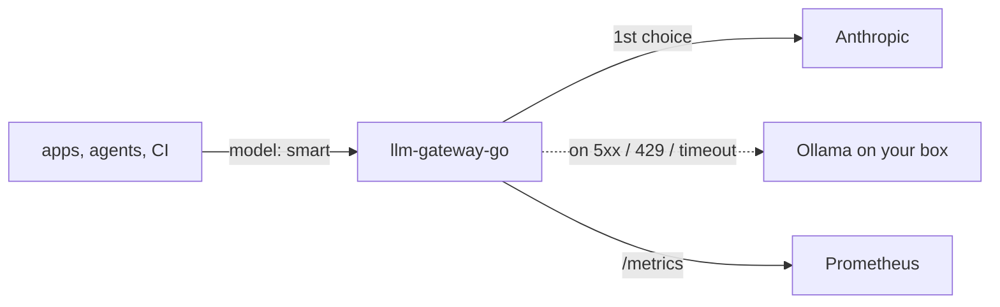

# llm-gateway-go

[](https://github.com/Urthella/llm-gateway-go/actions/workflows/ci.yml)

One OpenAI-compatible endpoint in front of all your LLM providers: model aliases with automatic fallback, per-client API keys and rate limits, streaming, and Prometheus metrics for tokens and cost. A single Go binary with **no dependencies** beyond the standard library.



Every major provider and local runtime serves the OpenAI chat completions API (Anthropic through its [compatibility endpoint](https://docs.anthropic.com/en/api/openai-sdk), Ollama, vLLM, LM Studio, OpenRouter, Groq, ...), so the gateway needs no per-provider translation code: it routes, retries and meters.

## Quick start

```bash
go install github.com/Urthella/llm-gateway-go@latest
cp gateway.example.json gateway.json
export ANTHROPIC_API_KEY=sk-ant-... GATEWAY_KEY_LAPTOP=$(openssl rand -hex 24) GATEWAY_KEY_CI=$(openssl rand -hex 24)
llm-gateway-go -config gateway.json
```

Point any OpenAI SDK or tool at it:

```bash
curl http://127.0.0.1:8080/v1/chat/completions \
  -H "Authorization: Bearer $GATEWAY_KEY_LAPTOP" -H "Content-Type: application/json" \
  -d '{"model": "smart", "messages": [{"role": "user", "content": "Hello"}]}'
```

```python
from openai import OpenAI
client = OpenAI(base_url="http://127.0.0.1:8080/v1", api_key=os.environ["GATEWAY_KEY_LAPTOP"])
```

## Configuration

See [gateway.example.json](gateway.example.json). Secrets never go in the file, only the names of the environment variables that hold them.

| Field | |
|---|---|
| `upstreams` | Name → `base_url` of an OpenAI-compatible API, plus `api_key_env` if it needs a key |
| `models` | Alias → routes tried in order, each an upstream and the model name it knows |
| `prices` | Upstream model → USD per million `input` / `output` tokens, for cost metrics. The example's numbers are placeholders: copy your provider's current prices |
| `keys` | Client name → `key_env` holding its bearer token, and `rpm`. With no keys at all, every request is "anonymous": keep it on localhost |

## Behavior

- **Fallback**: a network error, `429` or `5xx` moves on to the next route. Any other `4xx` is returned as is, since a bad request won't get better elsewhere. The response says who answered in `X-Gateway-Upstream`, and if every route fails you get a `502` listing each failure.
- **Rate limits**: per client, GCRA (the algorithm from [gcra-lite](https://github.com/Urthella/gcra-lite)): bursts up to a minute's worth, then one request per `60s / rpm`, with `Retry-After` on `429`.
- **Streaming**: server-sent events are forwarded event by event. The gateway sets `stream_options.include_usage`, so streamed calls are metered too; clients see one extra final chunk with empty `choices`, the standard OpenAI shape.
- **Requests stay intact**: only `model` (and the usage option above) is changed, so tools, `response_format` and anything provider-specific pass straight through.
- **Errors** come back in OpenAI's error format, so SDKs show the gateway's message.
- **Shutdown**: on `SIGINT` / `SIGTERM` it stops accepting requests and gives open streams 30 seconds to finish.

## Metrics

`GET /metrics` in the Prometheus text format:

```text
llm_gateway_requests_total{client="laptop",model="smart",upstream="anthropic",status="failover"} 1
llm_gateway_requests_total{client="laptop",model="smart",upstream="ollama",status="200"} 1
llm_gateway_tokens_total{client="laptop",model="smart",kind="prompt"} 1000
llm_gateway_cost_usd_total{client="laptop",model="smart"} 0.0007
```

Costs are estimates from your `prices`, and counters live in memory, so they reset on restart (Prometheus handles that for counters).

## Scope

Chat completions (streaming and not) and `GET /v1/models`, which lists your aliases. Embeddings and the Responses API aren't proxied yet.

## Develop

```bash
nix develop
go test -race ./...
```

The tests run the real handler against fake upstreams: fallback on `5xx` and `429` but not `4xx`, streaming pass-through with usage metering, auth, rate limits and metrics.

## License

[MIT](LICENSE)
